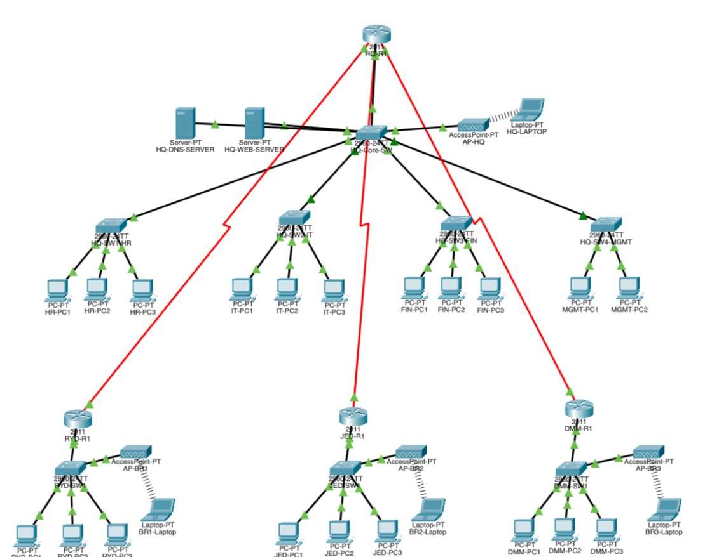
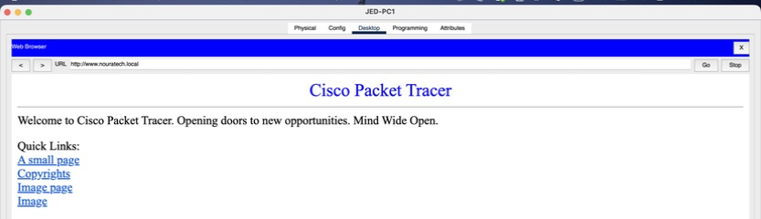
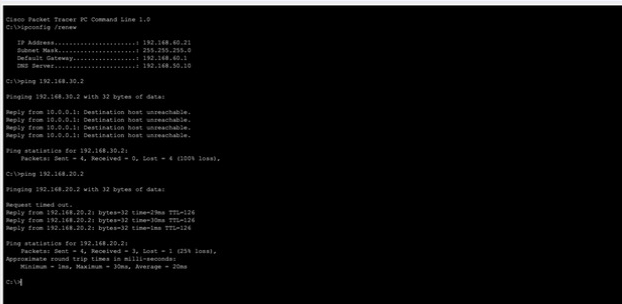
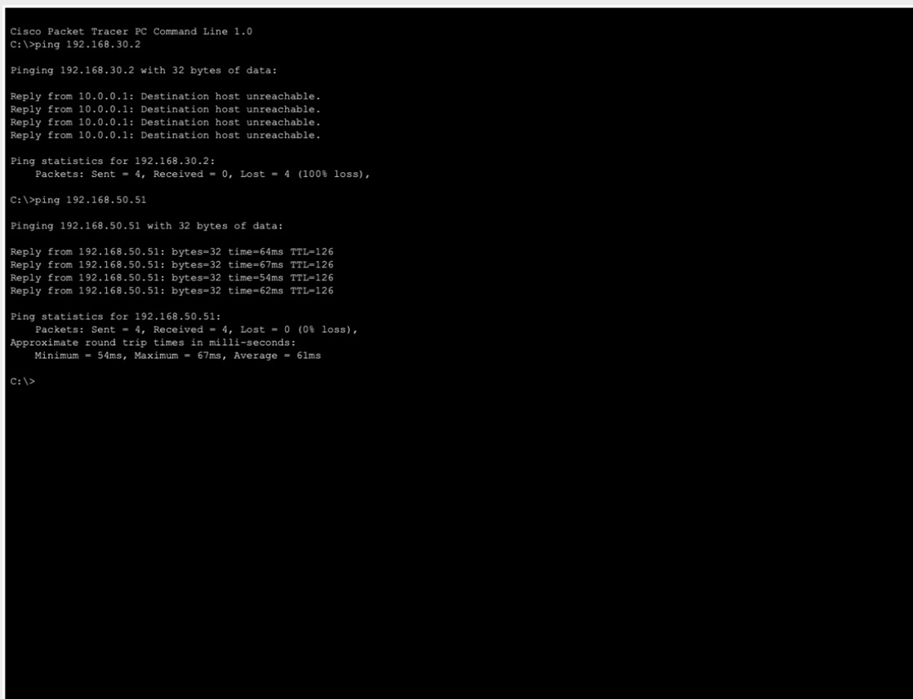
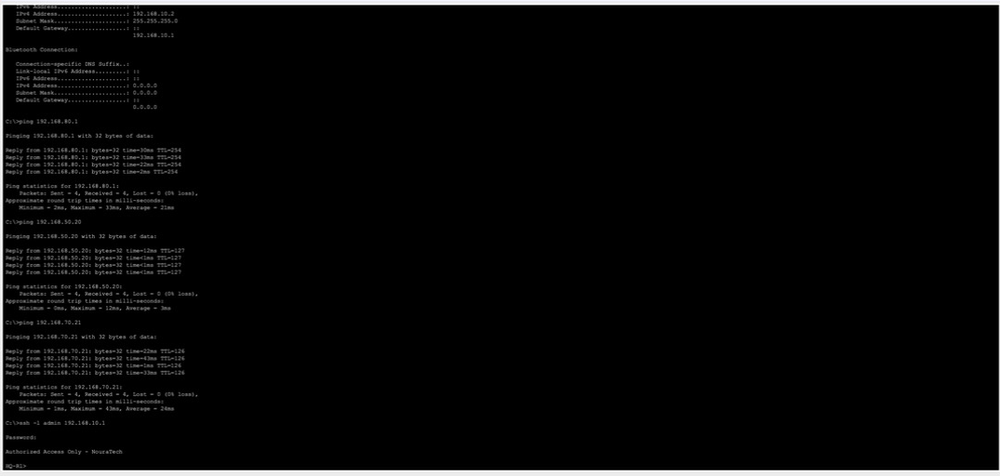
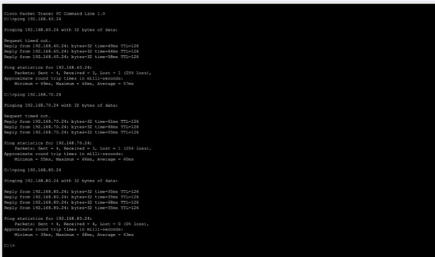

# NouraTech – Enterprise Multi-Branch Network

A complete enterprise network for the fictional company **NouraTech**, designed, configured and tested in **Cisco Packet Tracer 9.0.1**. The design connects a headquarters (HQ) with three branch offices (Riyadh, Jeddah, Dammam) over serial WAN links, with VLAN segmentation, dynamic routing, centralized network services, and layered security.



---

## Table of Contents
1. [Project Overview](#project-overview)
2. [Project Objectives](#project-objectives)
3. [Network Topology](#network-topology)
4. [Network Architecture](#network-architecture)
5. [IP Addressing Plan](#ip-addressing-plan)
6. [VLAN Configuration](#vlan-configuration)
7. [Routing and Network Services](#routing-and-network-services)
8. [Security Implementation](#security-implementation)
9. [Testing and Results](#testing-and-results)
10. [Tools and Technologies Used](#tools-and-technologies-used)
11. [Repository Structure](#repository-structure)

---

## Project Overview

NouraTech is a multi-site enterprise network that simulates a real company with one headquarters and three branches. The HQ hosts the company's departments (HR, IT, Finance, Management) on separate VLANs and runs the central DNS and web servers. Each branch has its own LAN and wireless access, and every site reaches the others through OSPF-routed serial links to the HQ router.

## Project Objectives

- Segment the HQ network by department using VLANs and inter-VLAN routing (router-on-a-stick).
- Connect the HQ and three branches with dynamic routing (**OSPF, single area 0**).
- Provide automatic addressing (**DHCP**) for every LAN and wireless network.
- Provide internal name resolution (**DNS**) and an internal website (`www.nouratech.local`).
- Restrict access to the Finance department with an **Access Control List**.
- Harden network devices with **SSH, enable secret, login banners and port security**.
- Offer secured **WPA2** wireless access at HQ and every branch.
- Verify every service with real connectivity tests.

## Network Topology

| Site | Router | Switches | End devices |
|---|---|---|---|
| **HQ** | HQ-R1 (Cisco 2911) | HQ-Core-SW, HQ-SW1-HR, HQ-SW2-IT, HQ-SW3-FIN, HQ-SW4-MGMT (Cisco 2960) | 11 PCs, DNS server, web server, AP-HQ, HQ-LAPTOP |
| **Branch 1 – Riyadh** | RYD-R1 (Cisco 2911) | RYD-SW1 | RYD-PC1..3, AP-BR1, BR1-Laptop |
| **Branch 2 – Jeddah** | JED-R1 (Cisco 2911) | JED-SW1 | JED-PC1..3, AP-BR2, BR2-Laptop |
| **Branch 3 – Dammam** | DMM-R1 (Cisco 2911) | DMM-SW1 | DMM-PC1..3, AP-BR3, BR3-Laptop |

## Network Architecture

- **Hub-and-spoke WAN:** HQ-R1 is the hub. Each branch router connects to it over a dedicated serial point-to-point link (/30).
- **HQ campus:** HQ-Core-SW is the collapsed core. It trunks to HQ-R1 (G0/0 ↔ Fa0/1) and to the four department access switches. The DNS server, web server and AP-HQ connect to it on the Servers VLAN.
- **Inter-VLAN routing:** router-on-a-stick on HQ-R1 using 802.1Q sub-interfaces `G0/0.10`–`G0/0.50`.
- **Branches:** each branch router's G0/0 is the LAN gateway. Wired PCs and the branch access point connect to the branch switch.
- **Wireless:** Access points bridge wireless clients into the local LAN, so laptops get their addresses from the same DHCP pool.

### WAN links

| Link | HQ-R1 interface | HQ-R1 IP | Branch interface | Branch IP |
|---|---|---|---|---|
| HQ ↔ Riyadh | S0/3/0 | 10.0.0.1/30 | RYD-R1 S0/3/0 | 10.0.0.2/30 |
| HQ ↔ Jeddah | S0/3/1 | 10.0.0.5/30 | JED-R1 | 10.0.0.6/30 |
| HQ ↔ Dammam | S0/2/0 | 10.0.0.9/30 | DMM-R1 | 10.0.0.10/30 |

## IP Addressing Plan

| Network | VLAN / Site | Subnet | Gateway | DHCP pool | DHCP excluded range |
|---|---|---|---|---|---|
| HR | VLAN 10 – HQ | 192.168.10.0/24 | 192.168.10.1 | HQ-LAN | .1 – .20 |
| IT | VLAN 20 – HQ | 192.168.20.0/24 | 192.168.20.1 | HQ-IT | .1 – .20 |
| Finance | VLAN 30 – HQ | 192.168.30.0/24 | 192.168.30.1 | HQ-FIN | .1 – .20 |
| Management | VLAN 40 – HQ | 192.168.40.0/24 | 192.168.40.1 | HQ-MGMT | .1 – .20 |
| Servers + HQ Wi-Fi | VLAN 50 – HQ | 192.168.50.0/24 | 192.168.50.1 | HQ-WIFI | .1 – .50 |
| Branch 1 LAN | Riyadh | 192.168.60.0/24 | 192.168.60.1 | RYD-LAN | .1 – .20 |
| Branch 2 LAN | Jeddah | 192.168.70.0/24 | 192.168.70.1 | JED-LAN | .1 – .20 |
| Branch 3 LAN | Dammam | 192.168.80.0/24 | 192.168.80.1 | DMM-LAN | .1 – .20 |
| WAN links | Serial | 10.0.0.0/30, .4/30, .8/30 | — | — | — |

**Static addresses**

| Device | IP address |
|---|---|
| HQ-DNS-SERVER | 192.168.50.10 |
| HQ-WEB-SERVER | 192.168.50.20 |

All DHCP pools hand out **192.168.50.10** as the DNS server.

## VLAN Configuration

| VLAN ID | Name | Access switch | Purpose |
|---|---|---|---|
| 10 | HR | HQ-SW1-HR | Human Resources |
| 20 | IT | HQ-SW2-IT | IT department |
| 30 | FINANCE | HQ-SW3-FIN | Finance (restricted by ACL) |
| 40 | MANAGEMENT | HQ-SW4-MGMT | Management |
| 50 | SERVERS | HQ-Core-SW | DNS/web servers and the HQ access point |

- PC ports on every access switch are **access ports** in their department VLAN.
- Uplinks between the access switches, HQ-Core-SW and HQ-R1 are **802.1Q trunks**. The core switch limits them to VLANs 10, 20, 30, 40 and 50.

## Routing and Network Services

### OSPF
All four routers run **OSPF process 1 in area 0** and advertise the WAN /30 networks (`10.0.0.0 0.0.0.255`) and their LAN subnets. HQ-R1 advertises 192.168.10.0–50.0, and each branch router advertises its own LAN.

```
router ospf 1
 network 10.0.0.0 0.0.0.255 area 0
 network 192.168.60.0 0.0.0.255 area 0   ! example: RYD-R1
```

### DHCP
Every router acts as the DHCP server for its own LANs (pools listed in the [IP Addressing Plan](#ip-addressing-plan)). Gateway and server ranges are excluded from each pool.

### DNS and web
- **HQ-DNS-SERVER (192.168.50.10)** has an A record: `www.nouratech.local → 192.168.50.20`.
- **HQ-WEB-SERVER (192.168.50.20)** runs HTTP and serves the internal site.

### Wireless
| Access point | SSID | Security |
|---|---|---|
| AP-HQ | NouraTech-HQ | WPA2-PSK (AES) |
| AP-BR1 | NouraTech-BR1 | WPA2-PSK (AES) |
| AP-BR2 | NouraTech-BR2 | WPA2-PSK (AES) |
| AP-BR3 | NouraTech-BR3 | WPA2-PSK (AES) |

## Security Implementation

| Control | Where | Details |
|---|---|---|
| **ACL 110** | HQ-R1, outbound on `G0/0.30` (Finance) | `deny ip 192.168.60.0 0.0.0.255 192.168.30.0 0.0.0.255` then `permit ip any any`. Branch 1 (Riyadh) cannot reach the Finance VLAN; all other traffic is allowed. |
| **SSH v2** | All 4 routers | `ip domain-name nouratech.local`, RSA keys, local user, `line vty 0 4` with `login local` and `transport input ssh` (Telnet disabled). |
| **Enable secret** | All routers and switches | Privileged mode protected with a hashed secret. |
| **MOTD banner** | All routers and switches | `Authorized Access Only - NouraTech` |
| **Port security** | Wired end-device ports | `maximum 2`, `mac-address sticky`, `violation restrict` |
| **Port security (AP uplinks)** | HQ-Core-SW Fa0/8 and Fa0/5 on each branch switch | `maximum 10`, sticky, `violation restrict`. The higher limit lets wireless clients behind the AP use the port while it stays protected. |
| **WPA2-PSK (AES)** | All access points | Encrypted wireless access |

> **Credentials:** all passwords, secrets and the WPA2 key were removed from the published files and replaced with `[REDACTED]`. See [Configurations](#repository-structure).

## Testing and Results

All tests were run inside the Packet Tracer simulation.

| # | Test | Source → Destination | Result |
|---|---|---|---|
| 1 | Inter-site routing (OSPF) | HR-PC1 (HQ) → DMM gateway 192.168.80.1 | ✅ 4/4 replies, 0% loss |
| 2 | Server reachability | HR-PC1 → HQ-WEB-SERVER 192.168.50.20 | ✅ 4/4 replies |
| 3 | HQ ↔ branch | HR-PC1 → JED PC 192.168.70.21 | ✅ 4/4 replies |
| 4 | DNS + HTTP | JED-PC1 (Branch 2) browser → `www.nouratech.local` | ✅ Page loaded |
| 5 | DNS + HTTP over Wi-Fi | HQ-LAPTOP browser → `www.nouratech.local` | ✅ Page loaded |
| 6 | Wireless + DHCP | HQ-LAPTOP, BR1/BR2/BR3-Laptop | ✅ Joined their WPA2 SSIDs; got 192.168.50.51, .60.24, .70.24, .80.24 |
| 7 | Wireless HQ ↔ branches | HQ-LAPTOP → BR1, BR2, BR3 laptops | ✅ Replies from all three |
| 8 | **ACL enforcement** | RYD-PC1 / BR1-Laptop (Branch 1) → Finance 192.168.30.2 | ✅ **Blocked** (Destination host unreachable) |
| 9 | ACL scope | RYD-PC1 (Branch 1) → IT 192.168.20.2 | ✅ Allowed |
| 10 | Secure management | HR-PC1 → `ssh -l admin 192.168.10.1` | ✅ Logged in, MOTD shown |

> The first reply of a ping to a new destination sometimes times out while ARP resolves. That is expected behavior.

### Screenshots

| Website from Branch 2 (DNS + HTTP) | Website from HQ-LAPTOP (Wi-Fi) |
|---|---|
|  |  |

| ACL: Branch 1 → Finance blocked, → IT allowed | ACL from BR1-Laptop + Wi-Fi to HQ |
|---|---|
|  |  |

| HQ → branches & servers, then SSH | HQ-LAPTOP → branch laptops |
|---|---|
|  |  |

## Tools and Technologies Used

- **Cisco Packet Tracer 9.0.1**
- Cisco 2911 routers, Cisco 2960 switches, Server-PT, AccessPoint-PT, PC-PT, Laptop-PT
- VLANs, 802.1Q trunking, router-on-a-stick
- OSPFv2 (single area)
- DHCP, DNS, HTTP
- Extended ACLs
- SSH v2, enable secret, MOTD banners, port security
- WPA2-PSK wireless

## Repository Structure

```
NouraTech-Enterprise-Network/
├── README.md
├── packet-tracer/
│   └── NouraTech-Enterprise-Network.pkt   # credentials redacted
├── configurations/                        # running-configs, secrets → [REDACTED]
│   ├── HQ-R1.txt  RYD-R1.txt  JED-R1.txt  DMM-R1.txt
│   ├── HQ-Core-SW.txt  HQ-SW1-HR.txt  HQ-SW2-IT.txt  HQ-SW3-FIN.txt  HQ-SW4-MGMT.txt
│   └── RYD-SW1.txt  JED-SW1.txt  DMM-SW1.txt
└── images/
    ├── network-topology.png
    └── test-*.png
```

### About the published Packet Tracer file
The `.pkt` in this repository is a separate copy prepared for publication. In it:
- `enable secret` and the local SSH user secret on every router and switch were replaced with the literal value `[REDACTED]`.
- The WPA2 passphrase on all access points and laptops was replaced with `[REDACTED]`.

Because both sides use the same placeholder, Wi-Fi association still works in this copy. To manage a device, set your own credentials first.

---

*Author: Almaha · Built as a networking project during training at Nourah Information Technology Company (NITC).*
